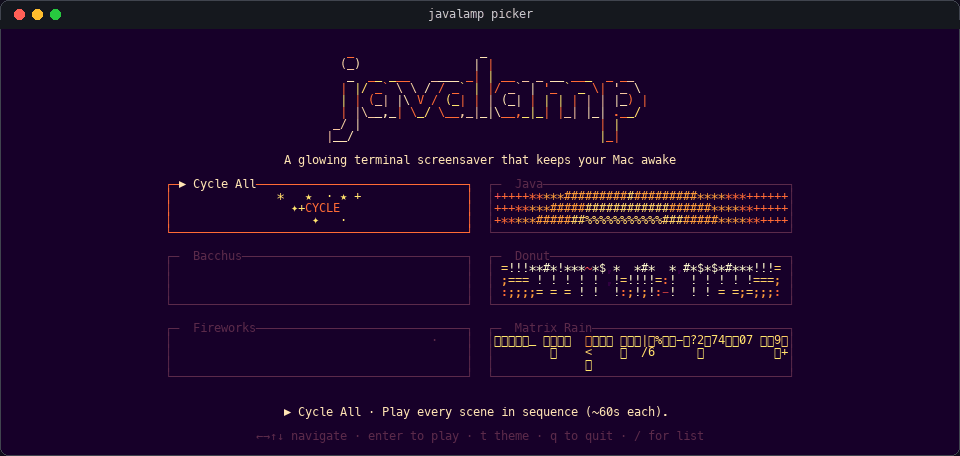

# javalamp

A glowing terminal screensaver that keeps your Mac awake.



## Install

From this repo:

```sh
make install
javalamp
```

After the PyPI release:

```sh
pipx install javalamp
javalamp
```

Requires Python 3.10+ and [pipx](https://pipx.pypa.io/). On macOS:

```sh
brew install pipx
```

## Run

```sh
javalamp              # open the scene picker
javalamp java         # play the Java scene
javalamp matrix       # play one scene directly
javalamp --cycle      # rotate through every scene
javalamp -l           # list scenes
```

While the picker or a scene is running:

```text
arrows  navigate
enter   play
t       cycle theme
q       quit
```

## What It Does

- Runs animated ASCII scenes in your terminal.
- Defaults to the warm `sunset` theme.
- Keeps your Mac awake with `caffeinate -d -i` while running.
- Restores your terminal cleanly when you quit.
- Lets you add custom scenes in `~/.config/javalamp/scenes/`.

Disable the macOS sleep guard when you want:

```sh
javalamp --no-caffeinate
```

## Optional System Stats

```sh
javalamp java --sysinfo
javalamp --cycle --sysinfo --zfs-pool tank
```

`--sysinfo` replaces the footer with available uptime, CPU usage/temperature,
RAM usage, NVIDIA GPU usage/temperature, Docker container counts and selected
ZFS pool health/capacity. Without the flag, the usual footer is unchanged and
no metrics are sampled. While the first sample is pending, or when no sources
are available, the usual footer is shown.

CPU, RAM and uptime use Linux `/proc`; CPU temperature uses supported Linux
`hwmon` devices. CPU usage is system-wide, normalized to 0-100%, not the CPU
usage of the javalamp process. Other platforms simply omit unavailable sources.
NVIDIA metrics require the optional `sysinfo` extra and a working NVIDIA driver;
from a source checkout, install it with `pip install -e '.[sysinfo]'`.

Docker is queried read-only through `/var/run/docker.sock` if accessible.
Socket access is privileged; do not broaden its permissions just for this
footer. ZFS is disabled unless `--zfs-pool NAME` selects a pool, and uses the
local `zpool` command without privilege escalation.

One background worker caches local metrics for 2 seconds, Docker counts for
10 seconds and ZFS data for 60 seconds. Docker uses a one-second socket timeout
and a 1 MiB response limit; `zpool` has a two-second timeout. Rendering reads
completed snapshots without waiting for probes. Exit waits for any active
sample before releasing GPU resources. Failed or unsupported sources are omitted.

## Develop

```sh
python -m venv .venv
source .venv/bin/activate
pip install -e ".[dev]"
pytest
```

Useful repo shortcuts:

```sh
make reinstall  # update the global command after editing
make test       # run tests
make list       # list scenes
```

Regenerate README media:

```sh
PYTHONPATH=src python scripts/render_readme_assets.py
```

## Custom Scenes

```sh
javalamp new-scene lava
javalamp check-scene lava
javalamp lava
```

See [SCENE_GUIDE.md](SCENE_GUIDE.md) for the tiny scene API.
